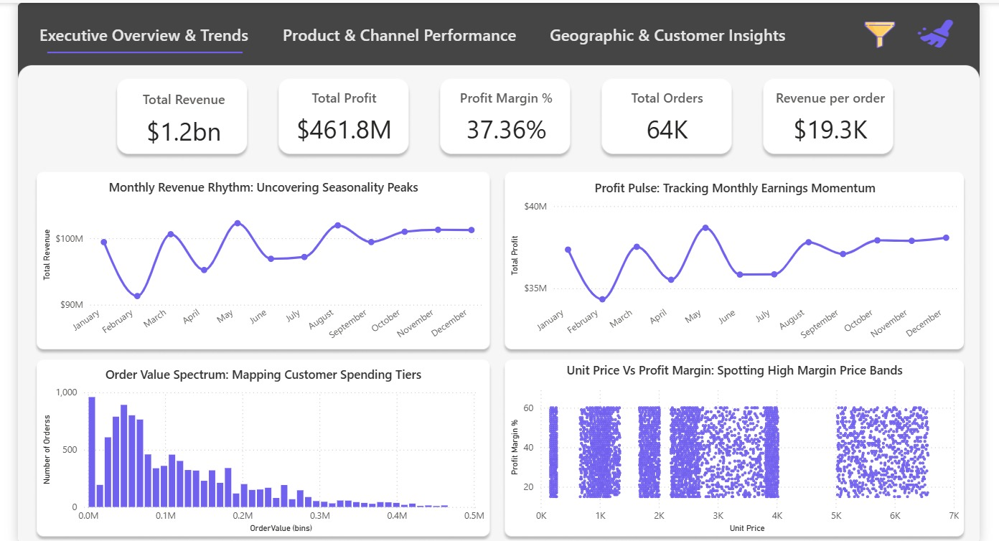
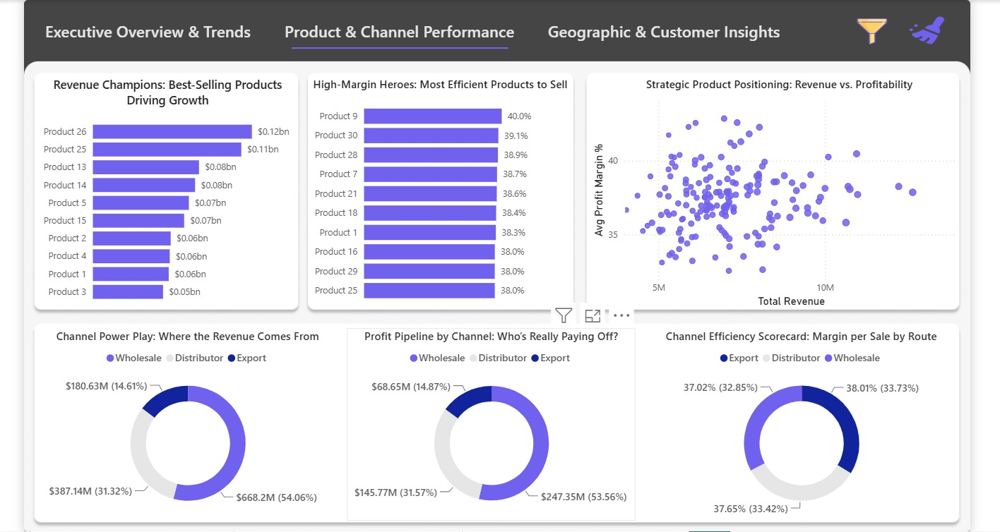
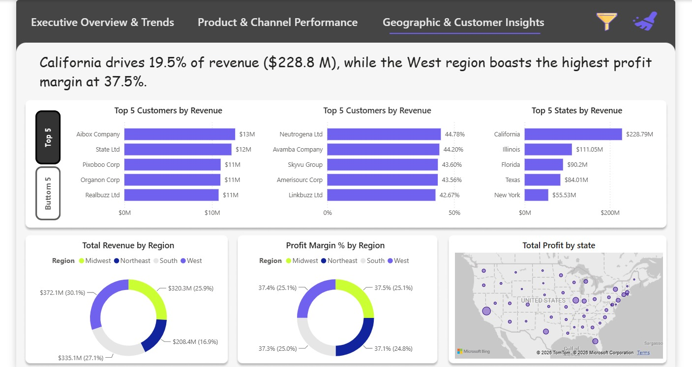

# Regional Sales Analysis

1. Project Overview

This project analyzes five years of historical U.S. sales data (2014–2018) to understand revenue trends, product performance, sales channel contributions, regional performance, and customer profitability.

The objective is to identify sales patterns, evaluate business performance, and uncover opportunities for improving revenue and profitability through data-driven insights.

The project uses Excel, Python, and Power BI as part of an end-to-end sales analytics workflow.

2. Business Problem Statement

The organization operates across multiple U.S. regions, products, customers, and sales channels. However, variations in revenue and profitability make it challenging to understand which areas contribute most to overall business performance.

The business needs better visibility into seasonal sales trends, product performance, channel contributions, regional differences, and customer profitability.

Main Business Question:

How can historical sales data be analyzed to identify revenue and profitability patterns, evaluate regional and product performance, and support better business decisions?

3. Dataset Summary

The project uses a multi-sheet Excel workbook containing five years of historical sales information (2014–2018).

The original dataset consists of six worksheets:

- Sales Orders
- Customers
- Products
- Regions
- State Regions
- 2017 Budgets

These worksheets contain information about:

- Order dates and transaction details
- Customer names and identifiers
- Product names and identifiers
- Sales quantities and unit prices
- Revenue and total unit costs
- Geographic regions and state information
- Product-level budgets for 2017

The six worksheets were consolidated into a single dataset for analysis.

4. Tools and Technologies

Tool| Purpose
Microsoft Excel| Source data exploration and inspection
Python (Pandas, NumPy)| Data preparation and analysis
Matplotlib and Seaborn| Data visualization and statistical analysis
Plotly| Interactive exploratory visualizations
Jupyter Notebook| Python development environment
Power BI| Interactive dashboards and business reporting

5. Project Workflow

A. Data Exploration and Preparation

The six Excel worksheets were examined to understand their structure, relationships, and relevant business information.

Key activities included:

1. Reviewing the structure of the six worksheets.
2. Examining columns, data types, and dataset dimensions.
3. Understanding relationships between sales, customers, products, and geographic tables.
4. Preparing the source tables for consolidation.

B. Data Cleaning and Transformation

Python and Pandas were used to prepare the data for analysis.

Key activities included:

- Preparing the State Regions table and setting the correct column headers.
- Merging the six worksheets using their corresponding identifiers.
- Removing redundant columns.
- Standardizing column names.
- Selecting and renaming relevant fields.
- Creating additional financial metrics, including total cost, profit, and profit margin percentage.
- Preparing date-related features for time-based analysis.

C. Exploratory Data Analysis (EDA)

Python libraries, including Pandas, NumPy, Matplotlib, Seaborn, and Plotly, were used to explore sales performance and identify business patterns.

The analysis covered:

- Monthly sales trends.
- Top-performing products by revenue.
- Product profitability.
- Sales channel contributions.
- Average order value distribution.
- Revenue and profit relationships.
- State and regional sales performance.
- Customer revenue and profitability.
- Correlation between numerical variables.

D. Power BI Dashboard

An interactive Power BI dashboard was developed to present sales performance, product and channel comparisons, and geographic and customer insights.

The dashboard contains three main sections:

1. Executive Overview & Trends

2. Product & Channel Performance

3. Geographic & Customer Insights

6. Key Business Insights

The analysis highlighted several important patterns:

1. Overall Performance: The Power BI dashboard reports approximately $1.2 billion in total revenue, $461.8 million in total profit, a 37.36% profit margin, and approximately 64K orders.
2. Product Performance: Products 26 and 25 were the leading products by revenue, generating approximately $117 million and $109 million respectively.
3. Sales Channel Performance: Wholesale contributed approximately 54.06% of revenue, followed by Distributor at 31.32% and Export at 14.61%.
4. Regional Performance: The West recorded the highest regional revenue in the EDA comparison, followed by the South, Midwest, and Northeast.
5. Geographic Performance: California was the leading state, generating approximately $228.8 million in revenue and recording around 7.6K orders.
6. Customer Performance: Aibox Company was identified as the leading customer by revenue, contributing approximately $13 million.
7. Seasonal Trends: Monthly sales patterns showed recurring fluctuations, with stronger performance around late spring and early summer and weaker performance in January.
8. Financial Relationships: Unit price showed strong positive correlations with cost, revenue, and profit, while order quantity had comparatively weaker correlations with financial variables.

7. Business Recommendations

Based on the analytical findings, the project proposes the following strategies:

1. Seasonal Promotions: Develop targeted promotions during weaker sales periods and use historical trends to improve seasonal planning.
2. Product Optimization: Prioritize high-revenue products such as Products 26 and 25 while monitoring the profitability of other products.
3. Channel Expansion: Leverage Wholesale's strong revenue contribution while exploring opportunities to expand Export sales and improve channel profitability.
4. Regional Investment: Use California's strong performance as a reference while identifying opportunities to strengthen sales in the Northeast and Midwest.
5. Profit Margin Monitoring: Monitor low-margin transactions, investigate cost drivers, and identify opportunities to improve profitability.

8. Project Deliverables

The project includes:

1. Original multi-sheet Excel sales dataset.
2. Cleaned and exported sales dataset in CSV format.
3. Python notebook for data preparation and exploratory data analysis.
4. Power BI interactive dashboard.
5. Three dashboard preview images.
6. Business insights and recommendations.

9. Skills Demonstrated

- Sales data analytics
- Data exploration and preparation
- Multi-table data consolidation
- Python and Pandas
- NumPy
- Exploratory data analysis
- Data visualization
- Statistical and correlation analysis
- Power BI dashboard development
- KPI analysis and performance reporting
- Business insights and recommendations
- Data-driven decision-making

10. Conclusion

This project demonstrates how historical sales data can be transformed into meaningful business insights through data preparation, exploratory analysis, and interactive visualization.

By analyzing revenue, profitability, products, sales channels, geographic performance, and customer patterns, the project provides a comprehensive view of business performance and highlights opportunities for improved sales planning and strategic decision-making.

The Power BI dashboard provides an interactive reporting solution for exploring key business metrics and monitoring sales performance.

11. Acknowledgement

This project was developed with reference to the Regional Sales Analysis educational project and learning resources shared by Satyajit Pattnaik.

YouTube Channel: "Satyajit Pattnaik" (https://youtube.com/@satyajitpattnaik)

Credit is given to the original creator for the project reference, learning materials, and source guidance.

The project has been adapted and organized as part of my personal data analytics portfolio.
